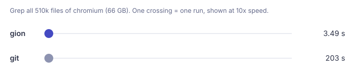

<div align="center">

# gion

<sub>*gion* (**GI-un**, "gi" as in **gi**t) = **g**it + sc**ion**</sub>

**Asymmetric git client for agents.**<br>
Skip the heavy network on large repos, get only what you need.

**[See it in action](#see-it-in-action)** · Works best with **[Baz](https://baz.ai)**

[](https://github.com/baz-scm/gion/actions/workflows/ci.yml)
[](https://github.com/baz-scm/gion/releases)
[](https://github.com/baz-scm/gion/releases)
[](https://baz-scm.github.io/gion/)
[](https://pkg.go.dev/github.com/baz-scm/gion)
[](LICENSE)


</div>

<p align="center"></p>


<sub>Measured on chromium (66 GB, 510k files), gion with a warm cache. [Full benchmarks](https://baz-scm.github.io/gion/performance/).</sub>

## Why

Git assumes every client keeps a full copy and can work offline. Agents and CI jobs are online all the time, usually read a few files, search a bit and push one change, and often run many at once on one machine. For them, a full clone is mostly waste. gion fetches files, trees and commits from the remote only when a task asks for them:

- **Fast starts:** no clone step. Read, search, diff and log any repo right away.
- **Small footprint:** a workspace holds only the paths you ask for. History stays on the server, so many agents can share one machine.
- **Full write path:** commit, push to branches and rebase with conflict resolution. Only new objects are sent.
- **Works with your server today:** gion speaks the standard git wire protocol, so GitHub and other git servers need no setup.

## See it in action

Demo clips are real time, not sped up.

**Read one file from a 66 GB repo.** Nothing lands on disk.


```sh
gion cat chromium/chromium abc2bc3fe6dd:README.md
```

**History of one file**, without a clone.


```sh
gion log chromium/chromium abc2bc3fe6dd --path README.md -n 5
```

**What a commit changed.** Only the files that differ are fetched.


```sh
gion diff chromium/chromium bfe93d2fd85a --path base/strings
```

**Check out one folder, edit and diff.** The workspace holds `docs` and the top-level files, nothing else.


```sh
gion clone chromium/chromium ./chromium --path docs --ref abc2bc3fe6dd
cd chromium && echo "hello" >> docs/README.md && gion diff
```

**Commit and push a branch** from a repo you can write to ([Workspaces](https://baz-scm.github.io/gion/workspaces/)).


```sh
gion commit -m "my change" --branch my-fix
```

## Install

```sh
curl -fsSL https://raw.githubusercontent.com/baz-scm/gion/main/install.sh | sh   # macOS, Linux
go install github.com/baz-scm/gion@latest                                     # or with Go
```

gion borrows your `gh` login, `GITHUB_TOKEN` or git credential helper; public repos need none.

- **CI:** in GitHub Actions, `uses: baz-scm/gion-action/checkout@v1` for a sparse checkout, or `baz-scm/gion-action/changed@v1` for a PR's changed files ([CI guide](https://baz-scm.github.io/gion/ci/)).
- **Agents:** run `gion skill install` so your coding agent uses gion instead of `git clone` ([agents guide](https://baz-scm.github.io/gion/agents/)).

## Commands

| Read anything | Work in a workspace | Write |
| --- | --- | --- |
| `cat`, `ls`, `ls-refs` | `clone --path`, `add` | `commit` (workspace or remote) |
| `find`, `grep` (whole repo) | `status`, `diff` | `rebase` (with conflict resolution) |
| `diff`, `log`, `blame` | `sync`, `switch` | `tag`, `branch rename` |

Every command takes `--md` for agent-friendly output and `-h` for its flags. See the [command reference](https://baz-scm.github.io/gion/reference/).

## Docs

**[baz-scm.github.io/gion](https://baz-scm.github.io/gion/)**: [getting started](https://baz-scm.github.io/gion/getting-started/), [CI](https://baz-scm.github.io/gion/ci/), [agents](https://baz-scm.github.io/gion/agents/), [workspaces](https://baz-scm.github.io/gion/workspaces/), [branches & rebase](https://baz-scm.github.io/gion/branches/), [search & history](https://baz-scm.github.io/gion/search-and-history/), [command reference](https://baz-scm.github.io/gion/reference/), [how it works](https://baz-scm.github.io/gion/how-it-works/), [performance](https://baz-scm.github.io/gion/performance/), [limitations & FAQ](https://baz-scm.github.io/gion/limitations/).

Working on gion itself? See [AGENTS.md](AGENTS.md).

## License

[Apache 2.0](LICENSE)
