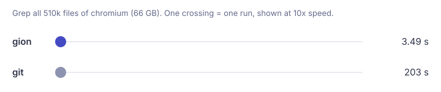

# gion

<sub>*gion* (**GI-un**, "gi" as in **gi**t) = **g**it + sc**ion**</sub>

**The fastest git client for agents.** Skip the heavy network on large repos, get only what you need.




<sub>Measured on chromium (66 GB, 510k files), gion with a warm cache. [Full benchmarks](performance.md).</sub>

## Why

Git assumes every client keeps a full copy and can work offline. Agents and CI jobs are online all the time, usually read a few files, search a bit and push one change, and often run many at once on one machine. For them, a full clone is mostly waste. gion fetches files, trees and commits from the remote only when a task asks for them:

- **Fast starts:** no clone step. Read, search, diff and log any repo right away.
- **Small footprint:** a workspace holds only the paths you ask for. History stays on the server, so many agents can share one machine.
- **Full write path:** commit, push to branches and rebase with conflict resolution. Only new objects are sent.
- **Works with your server today:** gion speaks the standard git wire protocol, so GitHub and other git servers need no setup.

## See it in action

Demo clips are real time, not sped up.

**Read one file from a 66 GB repo.** Nothing lands on disk.

<video class="demo" src="assets/demos/cat.mp4" autoplay loop muted playsinline></video>

```sh
gion cat chromium/chromium abc2bc3fe6dd:README.md
```

**History of one file**, without a clone.

<video class="demo" src="assets/demos/log.mp4" autoplay loop muted playsinline></video>

```sh
gion log chromium/chromium abc2bc3fe6dd --path README.md -n 5
```

**What a commit changed.** Only the files that differ are fetched.

<video class="demo" src="assets/demos/diff.mp4" autoplay loop muted playsinline></video>

```sh
gion diff chromium/chromium bfe93d2fd85a --path base/strings
```

**Check out one folder, edit and diff.** The workspace holds `docs` and the top-level files, nothing else.

<video class="demo" src="assets/demos/workspace.mp4" autoplay loop muted playsinline></video>

```sh
gion clone chromium/chromium ./chromium --path docs --ref abc2bc3fe6dd
cd chromium && echo "hello" >> docs/README.md && gion diff
```

**Monorepos: check out a project by name.** Name starting paths once in `.gion/projects.toml`. gion follows the manifests (npm, Cargo, Go, uv, Maven, …) to bring in the local packages each project depends on, and `[deps]` covers anything they don't show ([Projects](workspaces.md#projects-and-manual-dependencies)).

```toml
[projects]
web = ["apps/web"]

[deps]
"apps/web" = ["proto/web"]   # not in any manifest
```

```sh
gion clone acme/monorepo ./web --project web
```

To push, use a repo you can write to: `gion commit -m "my change" --branch my-fix` ([Workspaces](workspaces.md)).

## Will it help your repo?

Paste this into your coding agent (Claude Code, Codex, Cursor) from the root of your repo. It asks whether you want a quick look or a measured deep pass, then ranks where gion saves time and money.

```text
Assess where gion (https://github.com/baz-scm/gion) would save us significant
time or money. gion is a git client that reads, searches, diffs and pushes to
remote repos without cloning them, and checks out only the paths you ask for.

First ask me which pass I want (if you can't ask, do the quick look):
- Quick look: read https://baz-scm.github.io/gion/ (start with the CI, agents
  and performance pages) and the files in this repo. Install, clone and fetch
  nothing; estimate savings from the benchmarks in the docs.
- Deep pass: also install gion (https://baz-scm.github.io/gion/getting-started/),
  learn it from `gion help --md`, and time it against the current approach on
  the top 3-5 cases, cold and warm.

Then look at this repo:
1. Size: repo size, file count and history depth.
2. CI: every checkout step (actions/checkout, fetch-depth, sparse-checkout,
   submodules, LFS). Which jobs need only a few directories or only the PR's
   changed files? How often does each run? gion-action
   (https://github.com/baz-scm/gion-action) replaces these steps in GitHub
   Actions: checkout for a sparse checkout, changed for a PR's changed files.
3. Agents and scripts: anything that clones this or other repos just to read,
   grep or diff a few files (coding agents, bots, codegen, release tooling).
4. Developer workflows that pull the whole repo to work in one area
   (gion clone --path checks out only chosen paths; --project checks out one
   project plus the packages its manifests depend on).

For each opportunity: what changes, the gion command or gion-action step that
replaces it, and the saving (minutes per run x runs per month, CI minutes,
disk, network). Rank by impact. After a quick look, offer the deep pass.
```

## Where next

- [Getting started](getting-started.md): install, credentials, first commands
- [CI](ci.md): check out one directory or a PR's changed files in GitHub Actions
- [Agents](agents.md): install the gion skill so your agent uses gion instead of `git clone`
- [Command reference](reference.md): every command and flag
