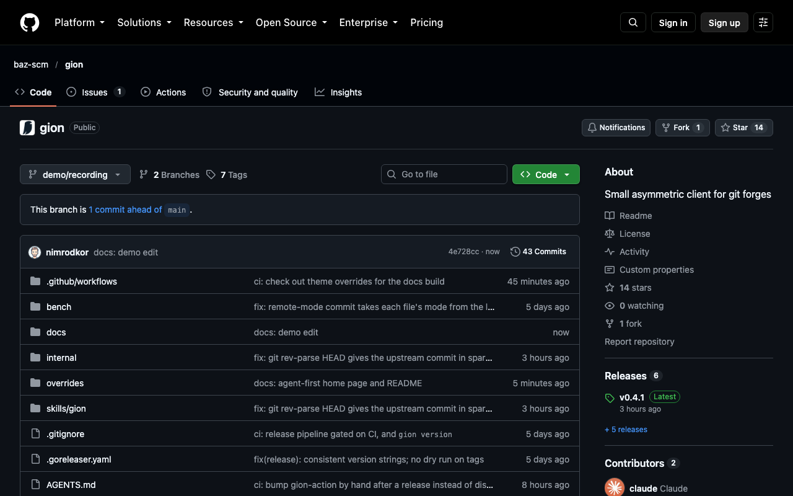

# Workspaces

A workspace is a directory with the files you chose at one commit, plus `.gion/state.json`. There is no history, and the remote branch is the only source of truth. A small `.git` lets git-based tools work ([below](#pre-commit-and-other-git-based-tools)).

```sh
gion clone baz-scm/baz ./baz --path services/api --path libs/auth
cd baz
$EDITOR services/api/handler.py
gion status
gion diff
gion commit -m "fix handler" --branch my-fix
```

## What a sparse clone contains

- Every file under each `--path` (a directory or a single file). Without `--path` you get the whole repo.
- The files directly inside each **parent directory** of those paths, the root included. That's where tools look for config, so `.gitignore`, `pyproject.toml`, `package.json`, `Cargo.toml`, `go.mod`, `conftest.py` and lint configs are there without naming them.

- The **local dependencies** of those paths (see below).

Edits to those parent-directory files are committed. New files you create next to them (scratch notes, logs) are not, unless you `gion add` them.

## Local dependencies

`clone --path` and `add` read the manifests under the paths you ask for and follow what they point at elsewhere in the repo, until no new paths turn up. Those paths join the workspace, and gion says why:

```text
$ gion clone baz-scm/baz ./bff --path bff
cloned baz-scm/baz@3bb443190f80 into bff: 822 files, 5.7 MiB (bff) in 2.1s
+ shared/fixer  (bff/package.json: "@baz/shared-fixer": "file:../shared/fixer")
```

| Ecosystem | What gion follows |
|---|---|
| npm, pnpm, yarn, bun | `file:`, `link:` and `portal:` dependencies; dependencies on packages of the workspace (`workspaces` in `package.json`, or `pnpm-workspace.yaml`), whether written `workspace:*` or as a version |
| Cargo | `path` dependencies (and `[patch]` / `[replace]` paths); every member of the crate's `[workspace]`, since cargo needs them all; `workspace = true` dependencies through `[workspace.dependencies]` |
| Go | local `replace => ./…` directives; every `use` of the `go.work` above the module |
| Python (uv) | `[tool.uv.sources]` paths; every member of the uv workspace the project belongs to |
| Maven | `<modules>`; the parent POM (`<relativePath>`, default `../pom.xml`); dependencies on other modules of the same reactor |
| Terraform | local module `source = "../…"` |
| Helm | `repository: file://…` chart dependencies |
| TypeScript | relative `extends` in `tsconfig*.json` (just that file) and project `references` |

Root lockfiles and workspace roots sit in a parent directory, so they come along anyway. Manifests under `node_modules`, `vendor`, `testdata`, `test_data` and `fixtures` directories are skipped.

If the dependencies together come to more than 5 GB, gion lists them instead of adding them, with the `gion add` command to take the ones you need. It measures with GitHub's API; on other hosts there's no cap. `--no-deps` on `clone` or `add` turns the whole thing off.

**Gradle isn't followed.** Gradle builds are scripts (`settings.gradle(.kts)`, `build.gradle(.kts)`), so paths can be computed at build time and reading them as text would miss or invent dependencies. For a Gradle project, `gion add` the included builds and projects yourself; `settings.gradle(.kts)` at the root comes with every sparse clone.

## Widening

```sh
gion add libs/shared          # fetch it at the workspace's commit and track it
gion add services/new-thing   # doesn't exist yet: it just joins the workspace
```

`add` never overwrites a file already on disk that differs from the repo; it lists those and changes nothing.

## Status, diff and .gitignore

`gion status` lists added, modified and deleted files inside the workspace's paths. Files outside them are ignored, so a sparse workspace never reports the rest of the repo as deleted. Untracked files matched by `.gitignore` (including nested ones and your global excludes file) are skipped; tracked files are always checked, as in git.

`gion diff [<path>...]` shows your edits as a unified diff.

## Committing

<video class="demo" src="../assets/demos/push.mp4" autoplay loop muted playsinline></video>

```sh
gion commit -m "msg" --branch my-fix   # first commit: create the branch
gion commit -m "more"                  # later commits update it
gion commit -m "hotfix" --to main      # push onto another existing branch
```

The first commit creates a branch (`gion/<timestamp>` if you don't name one). Pushes are compare-and-swap: if someone pushed to the branch in the meantime and changed other files, gion builds on top of their commit and writes their files to disk too; if they changed a file you edited, it stops and lists it. See [Branches & rebase](branches.md).

The pushed branch on GitHub, one commit ahead of `main`:



Identity comes from git's usual variables (`GIT_AUTHOR_NAME`, `GIT_AUTHOR_EMAIL`, `GIT_COMMITTER_*`, `*_DATE`) or `user.name` / `user.email` in `~/.gitconfig`.

## Keeping up with upstream

`gion sync` brings unedited files up to date with the branch. Files you've edited are kept; if upstream changed them too, nothing is written and the conflicting paths are listed. To replay your commits onto a newer base, use [`gion rebase`](branches.md#rebase).

<video class="demo" src="../assets/demos/sync.mp4" autoplay loop muted playsinline></video>

## pre-commit and other git-based tools

Tools like [pre-commit](https://pre-commit.com), `git diff` and `git ls-files` need a `.git`, so every workspace has one, which gion keeps in step on `add`, `sync`, `switch`, `commit` and `rebase` (`gion clone --no-git` leaves it out):

```sh
gion clone baz-scm/baz ./baz --path services/api
cd baz
pre-commit install                  # or husky / lefthook, as the repo sets up
$EDITOR services/api/handler.py
gion commit -m "fix handler" --branch my-fix   # runs the hooks, then pushes
pre-commit run --all-files          # check every workspace file, any time
```

That `.git` is a local snapshot, not a clone, with no history, on a branch named after the one you push to. `HEAD` is the upstream commit, so `git rev-parse HEAD` gives the real commit id, which is what to use for naming build artifacts (`sha-$(git rev-parse --short=7 HEAD)`). When the workspace holds the whole repo, `HEAD` is that commit itself, as in a depth-1 clone. In a sparse workspace git reads a local commit in its place (a [replace ref](https://git-scm.com/docs/git-replace)) whose tree holds exactly the workspace's files: the rest of the repo is simply absent, so `git status` stays quiet about it. `git rev-parse GION_HEAD` also gives the upstream commit, even with replace refs turned off. A local `git commit` goes nowhere; push with `gion commit`.

`gion commit` runs the `pre-commit` and `commit-msg` hooks (from `.git/hooks`, or `core.hooksPath` as husky sets it) the way `git commit -a` does: every change is staged first, so hooks that check staged files see all of them. If a hook fails, nothing is pushed; hooks that fix files (formatters) leave the fixes on disk, so commit again. `--no-verify` skips them.

## Running tests

A workspace runs whatever the files on disk allow. Add the test directories and the code they import with `gion add`; if that's most of the repo, push the branch and let CI run them.
